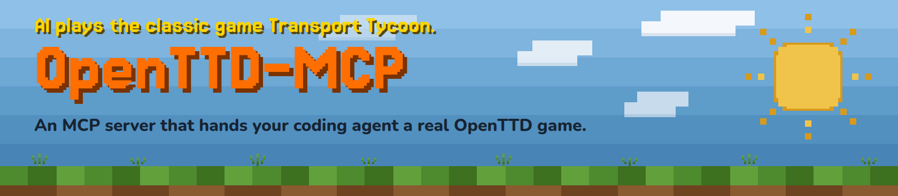

Let an AI agent play [OpenTTD](https://www.openttd.org/) through the Model Context
Protocol (MCP). The server starts a local game and gives the agent tools to
inspect towns, industries, and finances; build roads and stations; buy vehicles;
and manage routes. The agent chooses the strategy and each action.

The current gameplay tools support **road vehicles: buses and trucks**. The
default session runs headlessly, with no game window, on a 128 × 128 map with
16 towns starting in 1950. Each client connection owns a new game.

## Quick start

Clone this repository, open your coding agent in it, and say:

> Read AGENTS.md and README.md. Set up OpenTTD MCP for this client, run the
> smoke test, and confirm a real tool call works. Tell me where my saves will
> be and how to stop the game.

Then ask it to play:

> You are playing OpenTTD through the openttd MCP tools. All gameplay must go
> through those tools; don't use shell, browser, or files. Your goal is to
> maximize company profit and total cargo delivered.
>
> The game starts in January 1950 and runs in real time, even while you
> think. Play for three in-game years: check the date with get_my_finances as
> you go, and once it reaches 1 January 1953, call end_episode.
>
> The company keeps operating after the game ends, so don't sell off assets
> at the end to inflate your cash. Selling a genuinely bad investment
> mid-game is fine.
>
> After you end the game, finish with a recap: what you built, what worked,
> what failed, and how much the company is earning.

Three game years take about 40 minutes of real time. The game ends when your
agent session closes, which saves it as `final.sav`; see
[Saves and session behavior](#saves-and-session-behavior).

## Requirements

- **Linux on x86-64**, or **WSL 2** on Windows. The server drives a real
  OpenTTD 15.1 binary, and the setup script fetches that binary from
  **Ubuntu 26.04** packages, so Ubuntu 26.04 (native or in WSL 2) is the tested
  path. macOS and native Windows are not supported.
- Python 3.10 or newer and [uv](https://docs.astral.sh/uv/getting-started/installation/).
- `apt-get` and `dpkg`, with Ubuntu `main` and `universe` package lists available.
- An MCP client that allows long startup and tool-call times, such as Codex or
  Claude Code. The server needs no model API key.

## Manual setup

From the repository root (inside Ubuntu if using WSL):

```console
uv sync --locked --no-dev
python3 tools/setup_openttd_runtime.py
uv run --locked --no-dev python tools/smoke_test.py
```

The setup script downloads checksum-verified OpenTTD packages into `.local/`
and extracts them there; it does not install system packages. If APT cannot
find a pinned version, see the [runtime setup guide](docs/setup/openttd-runtime-setup.md).

The smoke test starts a real game, connects over MCP, makes a few tool calls,
and checks the final save. It needs no model. Allow up to ten minutes. A pass
prints `"ok": true` and the save path.

Then add the server to your client using
[Connect an MCP client](docs/setup/connect-a-client.md). The client runs:

```console
uv run --locked --no-dev --project /ABSOLUTE/PATH/TO/openttd-mcp openttd-mcp play
```

with `OPENTTD_MCP_REPO_ROOT=/ABSOLUTE/PATH/TO/openttd-mcp` in its environment.
Running this command yourself just waits for MCP messages; it isn't a game
console.

## Saves and session behavior

Closing the client connection shuts down its server process, which attempts to
save `final.sav` before quitting OpenTTD. Files are kept in
`.local/runs/<timestamp>-play/`, including game logs, tool calls, and startup and
cleanup reports. Check `play_cleanup.json` for confirmation of a successful
save. Forced termination can prevent saving. Reconnecting creates a fresh
game; `play` does not yet resume a saved game.

To look at a saved game in a graphical desktop or WSLg:

```console
uv run --locked --no-dev openttd-playtest /absolute/path/to/final.sav
```

For read-only agent review, the separate `openttd-mcp-inspector` command accepts
a save path. See [session options and saved games](docs/usage.md).

## Scope

This repository provides the MCP server, the OpenTTD bridge scripts, local
runtime setup, save inspection, and tests. An agent client supplies the model.
There is no hosted service or benchmark runner here. Gameplay supports roads,
not rail, ships, or aircraft. The simple `play` command exposes text tools;
the lower-level server also has optional vision support.

The [tool catalog](docs/tool-surface/tool-catalog.md) documents actions and
sensors and identifies optional tools. Ordinary play sessions do not
automatically run independent save verification.

## Development

```console
uv sync --locked
uv run pytest -q
uv run ruff check .
uv run ty check
uv run python tools/generate_tool_catalog.py --check
```

The tests use fake game processes and don't need OpenTTD installed. The
Squirrel bridge tests compile a small interpreter on first run, so they need
`make` and a C++ compiler (`build-essential` on Ubuntu).

## License

MIT; see [LICENSE](LICENSE). OpenTTD and its graphics, music, and libraries are
downloaded separately at setup and keep their own licenses. This is an
independent project, not affiliated with OpenTTD.
